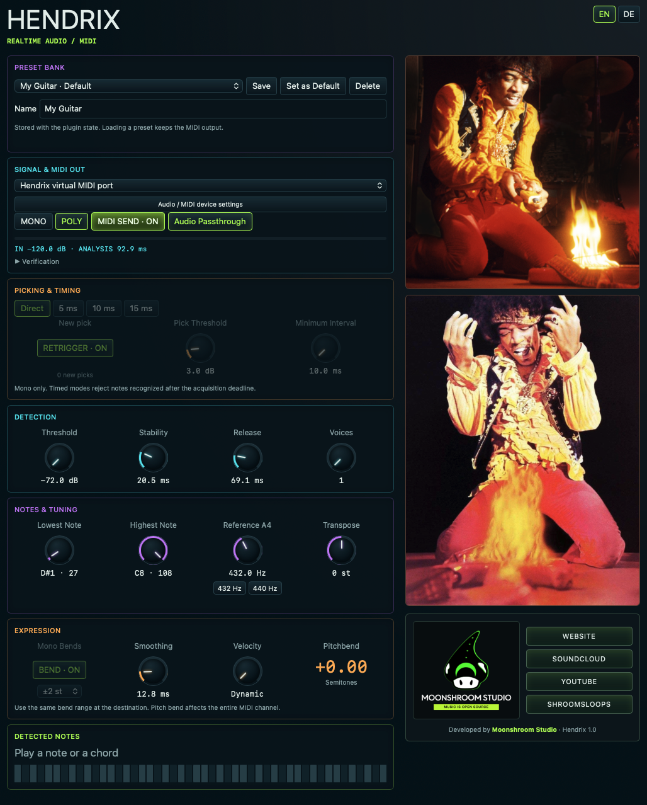

# HENDRIX

**Real-time audio-to-MIDI by Moonshroom Studio.**

Play a guitar or another instrument and drive a synthesizer with MIDI notes and expressive bends. Hendrix offers fast monophonic tracking and longer-window polyphonic analysis, with a picking detector for repeated notes.

[Website](https://moonshroom.moonshroom303.chatgpt.site/) · [SoundCloud](https://www.soundcloud.com/moonshroom303) · [YouTube](https://www.youtube.com/@moonshroom303) · [ShroomsLoops](https://shroomsloops-studio-231026.moonshroom303.chatgpt.site/#)

## Mobile beta

[Hendrix Mobile](mobile/) brings the audio-to-MIDI engine, guitar fretboard, keys and MIDI recording to Android and iOS. See the mobile page for platform features and build instructions.

- **Android 12+** · [Download APK](https://github.com/moonshroom303/hendrix/releases/download/mobile-v0.1.12/Hendrix-0.1.12-Android.apk)
- **iOS Simulator on Apple Silicon** · [Download ZIP](https://github.com/moonshroom303/hendrix/releases/download/mobile-v0.1.12/Hendrix-0.1.12-iOS-Simulator.zip)



## Downloads

[Hendrix 1.0](https://github.com/moonshroom303/hendrix/releases/tag/v1.0) provides three **Apple Silicon / macOS 12+** formats:

| Format | Package | Installation |
| --- | --- | --- |
| Audio Unit v2 | [Hendrix-1.0-macOS-arm64-AU.zip](https://github.com/moonshroom303/hendrix/releases/download/v1.0/Hendrix-1.0-macOS-arm64-AU.zip) | Copy `Hendrix.component` to `~/Library/Audio/Plug-Ins/Components/`. |
| VST3 | [Hendrix-1.0-macOS-arm64-VST3.zip](https://github.com/moonshroom303/hendrix/releases/download/v1.0/Hendrix-1.0-macOS-arm64-VST3.zip) | Copy `Hendrix.vst3` to `~/Library/Audio/Plug-Ins/VST3/`. |
| Standalone | [Hendrix-1.0-macOS-arm64-Standalone.zip](https://github.com/moonshroom303/hendrix/releases/download/v1.0/Hendrix-1.0-macOS-arm64-Standalone.zip) | Copy `Hendrix.app` to Applications or another local folder. |

Each ZIP includes installation instructions and license notices. The macOS packages are ad-hoc signed. The Rust detection library is independently reusable. [SHA-256 checksums](https://github.com/moonshroom303/hendrix/releases/download/v1.0/SHA256SUMS.txt).

## Getting sound

1. Feed the instrument's audio into Hendrix. In the standalone app, **Audio / MIDI device settings** opens the audio input/output and MIDI-device preferences. Allow microphone input when macOS requests it for an input you want to use.
2. Start with **MONO** for one note at a time. Use **POLY** for chords; polyphonic analysis takes longer.
3. Send Hendrix's MIDI to the synth you want to play. In a compatible DAW, use the plugin's MIDI output. If the host cannot route MIDI from an audio effect, choose **Hendrix virtual MIDI port** and select that port as the synth's MIDI input. Each instance has its own numbered port.
4. With the standalone app's first output option, MIDI goes to the device selected in its MIDI preferences. The virtual-port option also works with another application.
5. Enable **Audio Passthrough** to retain the original instrument audio. Disable it if you want to hear only the synth. Set the same pitch-bend range at the receiving synth.

The AU is a music effect, not a synthesizer. Hendrix itself does not generate a synth sound. Host MIDI-routing capabilities differ; the virtual port provides a macOS alternative.

## Controls and presets

- **EN / DE** changes the full main interface between English and German.
- **Direct** estimates a mono note from the first usable waveform cycle and verifies the provisional pitch afterward.
- **5 / 10 / 15 ms** are mono acquisition deadlines. Pitches recognized later are rejected.
- **Pick Threshold** and **Minimum Interval** control new attacks on a repeated note.
- The **A4 reference** has **432 Hz** and **440 Hz** presets. Turn the knob to set any reference between 400 and 480 Hz.
- Threshold, stability, release, voice count, lowest/highest note, transposition and velocity refine the tracking.
- Mono bends support ±2 / ±12 / ±24 semitones and adjustable smoothing. Pitch bend affects the entire MIDI channel; this is not independent per-note polyphonic bend.
- **Save** stores the current controls under the entered preset name. Loading preserves MIDI routing. The bank, language and controls are stored with plugin state; the standalone app remembers its own state.
- **Set as Default** also saves the bank and selected starting preset for newly created instances on this Mac. Existing project instances retain their saved state.
- Click the **Moonshroom Studio logo** to open the Moonshroom website. The four right-column buttons open Website, SoundCloud, YouTube and ShroomsLoops in the system browser.

The initial **My Guitar** preset uses the requested settings: Poly, −72 dB threshold, 20.5 ms stability, 69.1 ms release, one voice, D#1–C8, A4 = 431.4 Hz, zero transposition, dynamic velocity, Balanced verification and audio passthrough. Mono-only controls become available when MONO is selected.

## Latency and practical limits

Direct recognition needs a usable period of the played note. For a clean signal, the first estimate typically takes approximately one to one-and-a-half periods, plus block and hardware buffering. A4 at 440 Hz has a 2.27 ms period; low E near 82 Hz needs about 12.1 ms per period. Harmonics, noise and playing technique can produce a provisional wrong pitch.

The timed modes are detection limits, not guaranteed end-to-end audio-to-synth latency. Poly mode uses longer analysis windows. Practical instrument and DAW testing remains part of this first beta.

## Build the three macOS formats

Install Xcode command-line tools, CMake 3.22+, Python 3.9+, Git and Rust 1.88+.

```sh
python3 build_plugins.py
```

The helper fetches pinned official iPlug2 and VST3 SDK sources, applies two documented MIDI-adapter fixes and builds AU, VST3 and standalone into `build/formats/out/`. It does not install them into your plugin folders. It builds for the native architecture of the build machine; the published binaries here are arm64.

Existing pinned checkouts can be supplied with `--framework /path/iPlug2 --sdk /path/vst3sdk`. The permissive framework and SDK licenses are included in this repository.

## Rust library and integration

```sh
cargo test --locked --all-features
cargo run --locked --example first_note
cargo run --locked --features preview --bin hendrix-preview
```

`hendrix-preview` is an optional synthetic-tone interface demo, separate from the real standalone audio/MIDI app.

The library exports `Processor`, parameter metadata and `midi::MidiReader`. Prepare/allocate before processing, apply parameter changes at a safe block boundary and keep the reader's parameter snapshot synchronized. `ffi.rs` exposes the C-compatible bridge used by the native formats. UI telemetry reads a separate atomic output handle.

`MidiReader` owns only its emitted notes. Flush against the old destination before switching routes, disabling processing or removing an instance. Shared MIDI channels still require coordination by the host.

## Verification

[BUILD-TESTS.txt](BUILD-TESTS.txt) lists checks for the Rust library, AU and VST3 host loading, and the macOS packages.

## License

Copyright © 2026 **Moonshroom Studio**. Source is released under the [MIT License](LICENSE). Dependencies retain their own licenses; see [third-party notices](THIRD_PARTY_NOTICES.md) and `DEPENDENCY-LICENSES.txt`.

See [third-party notices](THIRD_PARTY_NOTICES.md) for the photographs and artwork used in the interface.
